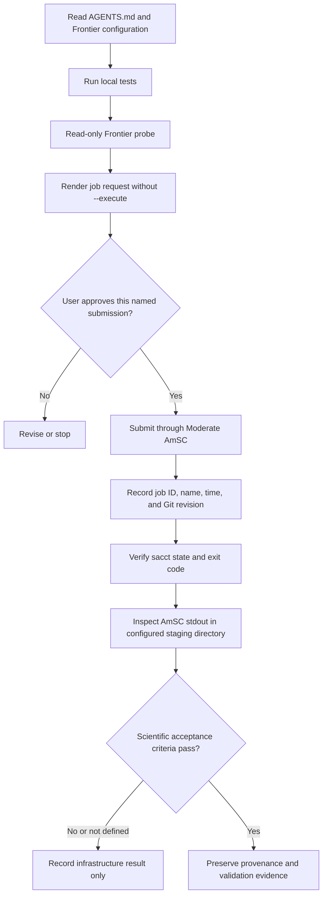
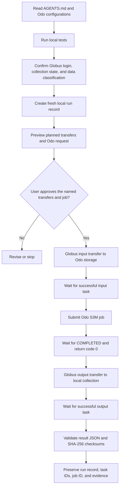

# User guide: Frontier and Odo agent skills

## Abstract

This guide describes two reusable agent skills for the ACE IRI concept:
\`olcf-frontier-workflow\` and \`olcf-odo-workflow\`. They help an agent prepare,
review, validate, and, only with explicit user authorization, operate the
reviewed Frontier and Odo workflow paths. The skills encode project-specific
constraints for OLCF enclaves, Slurm and AmSC job submission, Globus transfers,
run records, and reproducibility evidence. They do not contain credentials,
do not make remote changes by default, and do not establish scientific validity
merely because an infrastructure smoke test completes.

## Introduction

The ACE IRI concept repository contains tested proof-of-concept workflows for
OLCF systems. Frontier uses the Moderate-enclave AmSC Python Client. Odo uses
the Open-enclave S3M workflow, with a separate fixture path that stages input
through Globus, runs an Odo job, returns output, and verifies checksums.

The skills turn these repository-specific operating rules into concise,
reusable instructions for an agent. They direct the agent to the reviewed
configuration and detailed evidence rather than duplicating system settings or
credentials in prompts.

## Motivation

Running on an OLCF system involves decisions that ordinary coding guidance does
not capture:

- Frontier and Odo belong to different security enclaves and use different
  service paths.
- A credential may discover a resource while still being unable to submit a
  job.
- An interrupted transfer or job submission can leave an ambiguous state that
  must be inspected before any retry.
- A Slurm success state demonstrates that an execution path worked; it does
  not prove that a scientific model, input data, or result is valid.

The skills preserve those distinctions and make the safe, reviewed path easier
to follow repeatedly.

## Workflow diagrams

### Frontier through the Moderate AmSC client



### Odo fixture workflow through Open S3M and Globus



An interrupted or failed transfer or job does not follow the normal arrows.
Stop, preserve the run record, inspect the recorded task or job state, and
obtain explicit approval before any retry.

## Scope and functional requirements

### Frontier skill

\`olcf-frontier-workflow\` supports the reviewed Frontier workflow through
\`amsc_frontier.py\` and \`configs/frontier-amsc.json\`.

It must:

- use the OLCF Moderate AmSC endpoint and reviewed project staging directory;
- accept a user-managed Moderate authorization header by path only;
- support a read-only resource probe;
- render a one-node CPU smoke request before submission;
- require a fresh run ID and explicit authorization immediately before a live
  submission;
- verify completion through Slurm accounting and the AmSC stdout file; and
- preserve the returned job identifier and other selected provenance.

It does not support direct SSH Frontier jobs or Open-enclave S3M calls.

### Odo skill

\`olcf-odo-workflow\` supports the reviewed Odo workflow through
\`s3m_defiant.py\`, \`odo_globus_e2e.py\`, and the reviewed Odo configurations.

It must:

- use an Open-enclave authorization header by path only;
- render an Odo smoke-test request before submission;
- prepare and preview a stateful Globus fixture workflow;
- require explicit authorization immediately before each live job or transfer
  sequence;
- preserve the run record, Globus task IDs, Odo job ID, and final states; and
- validate fixture results using the documented JSON result and SHA-256
  checksums.

It does not support Frontier Moderate-enclave work or unreviewed scientific
datasets.

## Where the drafts are stored

The review drafts are in the repository:

\`\`\`text
ace-iri-concept/skills/olcf-frontier-workflow/SKILL.md
ace-iri-concept/skills/olcf-odo-workflow/SKILL.md
\`\`\`

They are not installed or activated as Codex skills yet. Keeping them in the
repository first allows peer review, version control, and pull-request review.
After approval, a separate installation step can copy or link the reviewed
packages into the user’s Codex skills directory.

## Local environment setup

Create an ignored project virtual environment from the project directory:

```bash
cd /Users/vga/projects/lcf-workflows/ace-iri-concept
python3 -m venv .venv
.venv/bin/python -m pip install --upgrade pip
.venv/bin/python -m pip install -r requirements-workflows.txt
```

The requirements file includes the package indexes needed for the reviewed
AmSC client and pins the validated client versions. Run all workflow commands
with `.venv/bin/python` or activate the environment with
`source .venv/bin/activate`.

## Configuration and environment variables

Keep user- and site-specific values outside program source. The reviewed JSON
files in `configs/` hold system, allocation, queue, collection, and storage
settings, as well as the reviewed job-environment entries. Copy and adapt them
through normal branch review when a new project, allocation, dataset, storage
location, or payload environment is needed. The templates may use `{run_id}`
and, for the Odo fixture, `{input_directory}` and `{output_root}`.

| Variable | Purpose | Used by |
| --- | --- | --- |
| `ACE_IRI_OPEN_HEADER_FILE` | Path to an owner-readable Open-enclave S3M authorization header. | Odo and Defiant S3M workflows. |
| `ACE_IRI_ODO_HEADER_FILE` | Path to an owner-readable Open-enclave header for the Odo–Globus program. | `odo_globus_e2e.py`. |
| `ACE_IRI_FRONTIER_HEADER_FILE` | Path to an owner-readable Moderate-enclave authorization header. | `amsc_frontier.py`. |
| `ACE_IRI_CONFIG_DIR` | Directory containing the reviewed S3M JSON configuration files. | `s3m_defiant.py`. |
| `ACE_IRI_FRONTIER_CONFIG` | Path to a Frontier AmSC JSON configuration file. | `amsc_frontier.py`. |
| `ACE_IRI_ODO_GLOBUS_CONFIG` | Path to an Odo–Globus JSON configuration file. | `odo_globus_e2e.py`. |
| `ACE_IRI_RUNS_DIR` | Ignored local directory for generated request, submission, and run records. | S3M and Odo–Globus workflows. |

For example, set paths in the current shell without exposing a token value:

```bash
export ACE_IRI_OPEN_HEADER_FILE="$HOME/.config/olcf/open-s3m.header"
export ACE_IRI_ODO_HEADER_FILE="$ACE_IRI_OPEN_HEADER_FILE"
export ACE_IRI_FRONTIER_HEADER_FILE="$HOME/.config/olcf/moderate-s3m.header"
export ACE_IRI_RUNS_DIR="$HOME/.local/state/ace-iri/runs"
```

The command-line `--header-file` and `--config` options take precedence over
these defaults. Store configuration paths, never credential values, in shell
startup files or a local environment manager.

The Frontier service endpoint and resource allowlist remain fixed in code as a
credential-routing safeguard. Moving that allowlist to editable configuration
could send a Moderate credential to an untrusted service. Storage locations,
allocations, queues, collection IDs, and local paths remain configuration
controlled.

## Acquiring and securing authorization headers

Create S3M tokens only through the approved OLCF account portal for the target
enclave and system. Create a separate token for the Open and Moderate enclaves;
do not reuse or cross-route them. Follow OLCF's current token instructions and
set the header file to one `Authorization:` header line.

Store each header outside the repository and restrict it to its owner:

```bash
mkdir -p "$HOME/.config/olcf"
chmod 700 "$HOME/.config/olcf"
chmod 600 "$ACE_IRI_OPEN_HEADER_FILE" "$ACE_IRI_FRONTIER_HEADER_FILE"
```

Do not paste a token into a prompt, shell history, source file, JSON
configuration, notebook, generated run record, issue, pull request, or log.
When a token expires or lacks authorization, replace only the external header
file through the approved portal, then use a new run ID for the next operation.

## Prerequisites

Before using either skill:

1. Work from a clean or understood Git branch. Never develop directly on
   \`main\`.
2. Read \`AGENTS.md\` and the relevant workflow documentation.
3. Use the project virtual environment and run the local test suite:

   \`\`\`bash
   cd /Users/vga/projects/lcf-workflows/ace-iri-concept
   make test
   \`\`\`

4. Keep S3M authorization headers outside the repository and owner-readable
   only. Give the agent a header-file path when needed; never give it a token
   value.
5. For the Odo–Globus fixture path, authenticate the Globus CLI and ensure the
   local collection is running before approving a transfer.

## Usage patterns

The examples below show the desired level of specificity in a request to an
agent. Replace bracketed placeholders with a fresh run ID or the appropriate
user-managed header-file path.

### Frontier: resource discovery

\`\`\`text
Use $olcf-frontier-workflow to probe Frontier with my Moderate header file.
Do not submit a job.
\`\`\`

The agent should perform only the documented read-only probe and report the
resource status. A successful probe does not prove that the credential can
submit a job.

### Frontier: preview a smoke request

\`\`\`text
Use $olcf-frontier-workflow to prepare a one-node CPU smoke request with run ID
[frontier-check-YYYYMMDD]. Render it for review only; do not execute it.
\`\`\`

The agent should render the request, identify the queue, allocation, staging
directory, command, and expected stdout path, then stop for review.

### Frontier: submit a reviewed request

\`\`\`text
Use $olcf-frontier-workflow. I approve submitting the reviewed Frontier request
with run ID [frontier-check-YYYYMMDD] using my Moderate header file. Report the
job ID, generated job name, expected stdout path, and final verification steps.
\`\`\`

This authorizes one named submission. It does not authorize additional retries,
cancellations, or changed requests.

### Odo: preview a smoke request

\`\`\`text
Use $olcf-odo-workflow to prepare an Odo CPU smoke test with run ID
[odo-check-YYYYMMDD]. Use my Open-enclave header file. Render the S3M request
only; do not execute it.
\`\`\`

The agent should show the reviewed request parameters and wait for explicit
approval before submission.

### Odo: prepare a Globus fixture run

\`\`\`text
Use $olcf-odo-workflow to prepare the Odo–Globus fixture workflow with fresh
run ID [globus-e2e-YYYYMMDDTHHMMSSZ]. Create the local run record and preview
the planned operations. Do not create a Globus transfer or submit an Odo job.
\`\`\`

The agent should create and inspect the local record only. It should explain
the planned input transfer, Odo job, output transfer, paths, and checks.

### Odo: execute an approved fixture run

\`\`\`text
Use $olcf-odo-workflow. I approve the specific fixture run
[globus-e2e-YYYYMMDDTHHMMSSZ], including its input Globus transfer, Odo job,
and output Globus transfer. Preserve its run record and report task IDs, job ID,
final states, and checksum validation.
\`\`\`

This authorizes one identified end-to-end run. It does not authorize deletion,
retry, or transfer of a different dataset.

## How to verify results

### Frontier

Record the AmSC job ID and generated job name. Verify the parent job with:

\`\`\`bash
sacct -X -j <job-id> --format=JobID,JobName,Partition,Account,AllocCPUS,State,ExitCode
\`\`\`

For the smoke test, expect \`COMPLETED\` with exit code \`0:0\`. Then inspect the
job-name-prefixed stdout file in the approved Frontier staging directory. The
detailed procedure is in \`docs/frontier-amsc-client.md\`.

### Odo fixture workflow

The run record tracks the input Globus task ID, Odo job ID, output Globus task
ID, and local paths. For the fixture, successful completion requires:

- successful final state for both Globus tasks;
- Odo completion with return code \`0\`;
- \`result.txt\` equal to \`4.000\`;
- the expected \`result.json\`; and
- matching SHA-256 entries for the input and output files.

Use the recorded run state and \`odo_globus_e2e.py validate\` rather than
restarting an interrupted workflow.

## Safety and security

### Credentials

- Never place a token value in a prompt, command history, source file, run
  record, commit, issue, or pull request.
- The agent may receive a path to an external authorization-header file. It
  must not read or display that file’s contents.
- Use Moderate credentials only for Frontier and Open credentials only for Odo
  and Defiant.

### Authorization and recovery

- A read-only probe, a job submission, a cancellation, a retry, and a Globus
  transfer are different actions. Explicitly authorize the exact action at the
  time it is needed.
- Always use a fresh run ID for a live operation.
- After a failure, timeout, or interruption, preserve the local record and
  inspect the recorded job or task. Do not automatically retry or remove the
  record to bypass duplicate-operation protections.
- Confirm data classification and the approved enclave before any transfer.
  Do not move Moderate-enclave data through Open-enclave services.

### Scientific integrity

Before a scientific payload, document the question, dataset version,
classification, expected result, acceptance criteria, validation method, code
revision, environment details, and random seed when applicable. Preserve
checksums and transfer lineage. An independent rerun from a clean checkout or
separate environment is required before calling a payload reproducible. See
\`docs/research-integrity.md\`.

## Testing and validation of the skills

The skill packages are validated in three layers:

1. **Skill structure:** run the Codex skill validator with the project virtual
   environment, which provides PyYAML:

   \`\`\`bash
   .venv/bin/python \
     /Users/vga/.codex/skills/.system/skill-creator/scripts/quick_validate.py \
     skills/olcf-frontier-workflow

   .venv/bin/python \
     /Users/vga/.codex/skills/.system/skill-creator/scripts/quick_validate.py \
     skills/olcf-odo-workflow
   \`\`\`

2. **Repository checks:** run \`make test\`. The existing suite runs local shell
   syntax and unit tests; it does not contact OLCF or Globus.

3. **Preview checks:** render a Frontier request without \`--execute\`; for Odo,
   create a fresh local record and preview it without \`--execute\`. Do not run
   a live job or transfer simply to test the skill.

## Troubleshooting

| Situation | Response |
| --- | --- |
| The Frontier probe succeeds but submission is unauthorized | Stop. The credential may reach public discovery but lack Frontier Moderate submission access. Replace the external credential through the approved process, then use a new run ID. |
| Frontier status lookup is unreliable after submission | Preserve the job ID. Use \`sacct\` and inspect the documented stdout location. Do not resubmit until the existing job is understood. |
| A Globus task reports \`FILE_NOT_FOUND\` | Check whether the Odo job completed and created output before requesting a return transfer. Preserve the record and inspect task/job states. |
| A workflow reports a duplicate run record | Treat it as a safeguard. Inspect the existing record; do not delete it or reuse its run ID. |
| The skill validator reports \`No module named yaml\` | Invoke the validator with \`.venv/bin/python\`, not the system \`python3\`. |

## Related materials

- \`AGENTS.md\` — project operating policy.
- \`docs/frontier-amsc-client.md\` — validated Frontier smoke procedure.
- \`docs/odo-s3m-smoke-test.md\` — Odo S3M smoke procedure.
- \`docs/odo-globus-orchestrator.md\` — Odo–Globus fixture procedure and recovery.
- \`docs/research-integrity.md\` — provenance and reproducibility requirements.
- \`docs/handoff-defiant-s3m.md\` — context for a future collaborator or agent.

## Review status

This guide and the two skill packages are drafts for review. They have passed
the repository’s local test suite and the Codex skill validator, but no live
system operation was performed to validate the drafts. Review and approval are
required before committing, installing, or activating them.
